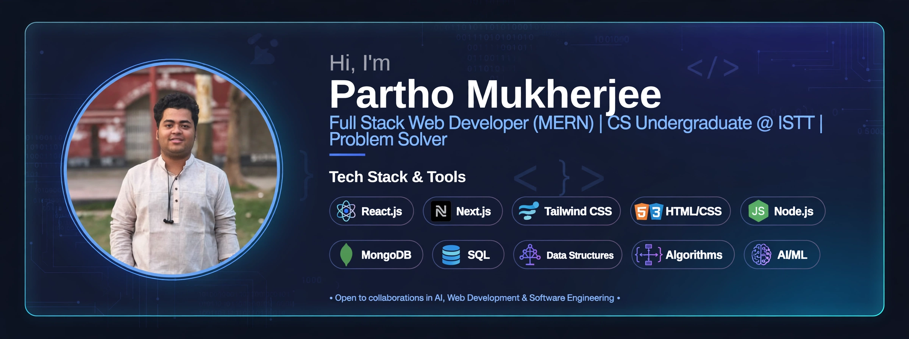

  

  

  
  
  

## About me

I am a **Computer Science & Engineering undergraduate at ISTT, Mirpur-13, Dhaka**, focused on full-stack web development and practical software engineering. I enjoy turning ideas into clean, responsive, and maintainable products while strengthening my foundation in data structures, algorithms, and problem solving.

- 💻 Building full-stack applications with the **MERN ecosystem and Next.js**
- 🧠 Practicing **DSA, problem solving, AI, and machine learning fundamentals**
- 🔐 Learning secure authentication and role-based application architecture
- 🤝 Open to collaboration on meaningful web, AI, and developer-tool projects
- 📍 Based in Dhaka, Bangladesh

## Tech stack

### Languages

### Frontend

### Backend, databases & tools

## Featured projects

| Project | Description | Repository |
| --- | --- | --- |
| **HireLoop** | Recruitment platform with recruiter and job-seeker workflows, authentication, and dashboards. | [Client](https://github.com/Partho-Mukherjee2003/hireloop-client) · [Server](https://github.com/Partho-Mukherjee2003/hireloop-server) |
| **BookNook** | Full-stack online library for browsing, adding, borrowing, and returning books. | [Client](https://github.com/Partho-Mukherjee2003/book-nook-client-site) · [Server](https://github.com/Partho-Mukherjee2003/book-nook-server-site) |
| **My FitLog** | Dark, responsive workout planner and progress-tracking application. | [View repository](https://github.com/Partho-Mukherjee2003/my-fit-log-app) |
| **BazarDor** | Bangladesh market-price application for everyday essentials with clear price-change indicators. | [View repository](https://github.com/Partho-Mukherjee2003/my-bazar-dor-app) |
| **My Dev Stack** | Interactive React and TypeScript app for exploring and customizing a developer stack. | [View repository](https://github.com/Partho-Mukherjee2003/my-dev-stack-react) |

## GitHub statistics

These cards use my exact GitHub username and display public GitHub activity through verified dynamic endpoints.

  
  

  

## Connect with me

| Platform | Contact |
| --- | --- |
| LinkedIn | [partho-mukherjee-0012b421b](https://www.linkedin.com/in/partho-mukherjee-0012b421b) |
| Portfolio | [my-portfolio-website-orpin-eight.vercel.app](https://my-portfolio-website-orpin-eight.vercel.app/) |
| Email | [parthomukherjee582@gmail.com](mailto:parthomukherjee582@gmail.com) |
| WhatsApp | [+880 1778-827812](https://wa.me/8801778827812) |
| Facebook | [partho.mukherjee.144](https://www.facebook.com/partho.mukherjee.144) |
| X / Twitter | [@Partho_M_2005](https://x.com/Partho_M_2005) |

  <i>Thanks for visiting my profile. Let's build something meaningful together! 🚀</i>

