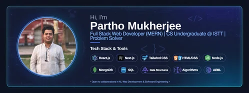

  

<!-- Animated intro line -->

  

  <b>Full Stack Web Developer (MERN) | CS Undergraduate @ ISTT | Problem Solver</b> 
  <i>Striving to write clean code, solve complex problems, and build impactful software.</i>

  
  
  
  
  
  

---

### 👨‍💻 About Me

I am a dedicated **Computer Science & Engineering (CSE)** student with a strong passion for building modern web applications and exploring Artificial Intelligence. I focus on writing clean, scalable code and continuously strengthening my core foundation in **Data Structures & Algorithms**.

- 🎓 Pursuing B.Sc. in **Computer Science & Engineering** at **ISTT, Mirpur-13, Dhaka**.
- 🚀 Deepening my knowledge in **Full-Stack Web Development** — MERN Stack & Next.js.
- 🧠 Actively practicing **DSA & Problem Solving** in C++ and Python to sharpen my analytical thinking.
- 🤖 Exploring the fundamentals of **AI & Machine Learning**.
- 🎯 Goal: Evolving into a full-fledged **Software & AI Engineer**.

---

### 🛠️ Tech Stack & Tools

#### 💻 Programming Languages

  
  
  
  
  
  

#### 🎨 Frontend

  
  
  
  

#### ⚙️ Backend & Databases — MERN

  
  
  
  
  
  

#### 🧠 Core Skills

  
  
  
  

#### 🧰 Tools & Version Control

  
  
  
  

---

### 🚀 Featured Projects

#### 📚 BookNook — Full-Stack Online Library Management App
A full-stack library app to discover, add, and borrow books, with login and personal collections.
- **Tech:** Next.js, TypeScript, React, Express.js, MongoDB Atlas, Better Auth
- **Features:** New Arrivals, All Books, Book Details, Add Book, My Books, My Borrows, Login / Register, Profile

#### 🏋️ FitLog — Workout Tracking App
A workout app to plan and track training, with saved plans and progress views.
- **Tech:** Next.js, TypeScript, Tailwind CSS, DaisyUI
- **Features:** Workouts, My Plan, Plan & Saved counters

> More projects are on my [portfolio](https://my-portfolio-website-orpin-eight.vercel.app/) and in my pinned repositories below.

---

### 📊 GitHub Statistics

  
  

  

---

### 🤝 Connect With Me

| Platform | Link |
| :--- | :--- |
| 💼 LinkedIn | [linkedin.com/in/partho-mukherjee-0012b421b](https://www.linkedin.com/in/partho-mukherjee-0012b421b) |
| 🌐 Portfolio | [my-portfolio-website-orpin-eight.vercel.app](https://my-portfolio-website-orpin-eight.vercel.app/) |
| 📧 Email | [parthomukherjee582@gmail.com](mailto:parthomukherjee582@gmail.com) |
| 💬 WhatsApp | [+880 1778-827812](https://wa.me/8801778827812) |
| 📘 Facebook | [facebook.com/partho.mukherjee.144](https://www.facebook.com/partho.mukherjee.144) |
| 𝕏 X / Twitter | [x.com/Partho_M_2005](https://x.com/Partho_M_2005) |

  <i>"Striving to write clean code, solve complex problems, and build impactful software."</i>

---

  Thanks for visiting my profile! 👋

